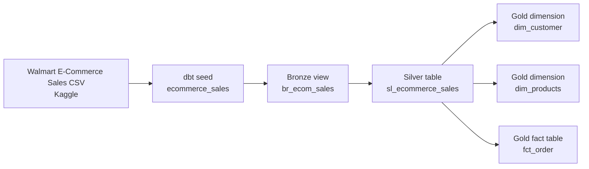

# Walmart E-Commerce Analytics Pipeline | dbt, PostgreSQL & Docker

A containerized analytics engineering project that transforms Walmart e-commerce sales data from Kaggle into cleaned, reporting-ready PostgreSQL tables. The project uses dbt, SQL, PostgreSQL 15, and Docker Compose to implement a local Medallion Architecture pipeline.

## Project overview

This project demonstrates an end-to-end local ELT workflow:

- Load a Walmart e-commerce sales CSV from Kaggle into PostgreSQL using dbt seeds.
- Transform the raw data through Bronze, Silver, and Gold layers.
- Apply SQL data-quality rules to standardize values, remove invalid records, and resolve duplicate transactions.
- Build a reporting-ready dimensional model containing customer and product dimensions plus an order fact table.
- Run the complete environment consistently with Docker Compose.

> **Data source:** Walmart e-commerce sales data from Kaggle. This repository is intended for educational and portfolio purposes. Review the original Kaggle dataset license and terms before redistributing the raw data.

## Architecture

```text
Kaggle Walmart E-Commerce Sales CSV
                |
                | dbt seed
                v
PostgreSQL raw seed: ecommerce_sales
                |
                v
Bronze: br_ecom_sales
                |
                v
Silver: sl_ecommerce_sales
                |
        +-------+--------+
        |       |        |
        v       v        v
Gold: dim_customer  dim_products  fct_order
                |
                v
          BI / Reporting
```

## Skills demonstrated

- SQL transformations using CTEs, `CASE` expressions, filters, casts, window functions, and derived metrics.
- dbt model development, materializations, seeds, model references, dependency management, and local documentation/lineage.
- Medallion Architecture design: Bronze, Silver, and Gold data layers.
- Dimensional modeling with fact and dimension tables.
- PostgreSQL data warehousing and SQL validation.
- Docker and Docker Compose for repeatable local development environments.
- Data-quality remediation and transaction deduplication.

## Tech stack

| Technology | Role in the project |
|---|---|
| dbt Core 1.11.6 | Transforms, materializes, and documents warehouse models |
| dbt-postgres 1.10.0 | Connects dbt Core to PostgreSQL |
| PostgreSQL 15 | Local analytical warehouse |
| Docker / Docker Compose | Runs dbt and PostgreSQL in a reproducible local environment |
| Python 3.11 | Base image for the dbt container; supports source-data generation |
| SQL | Data cleansing, transformation, dimensional modeling, and aggregation logic |
| Kaggle | Walmart e-commerce sales data source |

## Project structure

```text
DBT_Project_2/
├── data_source/
│   └── generate-sales.py
├── dbt_project/
│   ├── .dbt/
│   │   └── profiles.yml                 # Local file; do not commit credentials
│   └── dbt_ecomm2/
│       ├── models/
│       │   ├── bronze/
│       │   ├── silver/
│       │   └── gold/
│       ├── seeds/
│       │   └── ecommerce_sales.csv
│       └── dbt_project.yml
├── docker-compose.yml
└── Dockerfile
```

## Requirements

Install these tools before running the project:

- Docker Desktop with Docker Engine running.
- Hardware virtualization enabled; Windows users should enable WSL 2 when using Docker Desktop.
- Git, if cloning or publishing the project.
- Python 3.11+ only when running the optional data-generation script.

dbt and PostgreSQL do not need to be installed directly on the host machine because they run inside Docker containers.

## Data workflow

### 1. Source and seed load

The project uses a CSV containing Walmart e-commerce sales data from Kaggle. The file is placed in the dbt `seeds` folder and loaded to PostgreSQL with `dbt seed`.

This makes the raw dataset available as a database relation named `ecommerce_sales`, which is then referenced by downstream models using dbt's `ref()` function. `ref()` establishes model dependencies, allowing dbt to determine the correct build order and generate lineage. [dbt ref documentation](https://docs.getdbt.com/reference/dbt-jinja-functions/ref)

### 2. Bronze layer: raw-access model

The Bronze layer provides a controlled, traceable access point to the seeded source data.

- Uses a dbt **view** materialization.
- Preserves the source fields without business transformations.
- Establishes a clear separation between raw loaded data and cleansed analytical data.
- Provides an upstream model for all Silver-layer transformations.

### 3. Silver layer: data cleansing and standardization

The Silver model materializes a cleaned PostgreSQL table. It uses Common Table Expressions (CTEs) to separate cleansing rules from deduplication logic, making the SQL easier to test and maintain.

SQL techniques demonstrated:

| SQL technique | Application in the pipeline |
|---|---|
| CTEs | Separates the cleaning stage from the duplicate-resolution stage |
| `CAST` | Converts order-date values to a consistent date data type |
| `CASE WHEN` | Standardizes country values and repairs invalid quantity and price values |
| `WHERE` filters | Removes records without a customer ID and excludes future-dated orders |
| `ROW_NUMBER()` window function | Assigns a rank within each transaction ID to identify duplicate records |
| `PARTITION BY` | Groups duplicate candidates by transaction ID |
| `ORDER BY` within the window | Prioritizes the most recent dated record when duplicates exist |

Data-quality rules applied:

- Keeps recognized country codes and maps unrecognized values to `Unknown`.
- Replaces non-positive quantities with `1`.
- Replaces non-positive prices with `0`.
- Removes records where `customer_id` is missing.
- Removes orders dated after the pipeline run date.
- Retains one record per `transaction_id` after duplicate resolution.

### 4. Gold layer: dimensional reporting model

The Gold layer transforms the cleaned Silver table into reporting-ready tables using a star-schema-style design.

| Gold model | Grain | Purpose |
|---|---|---|
| `dim_customer` | One row per customer | Stores customer name and country attributes for customer and geographic analysis |
| `dim_products` | One row per product | Stores product category information for product analysis |
| `fct_order` | One row per transaction | Stores order activity, foreign keys, order status, quantity, price, and sales value |

The fact table calculates a transaction-level sales metric:

```text
total_amount = quantity × price
```

This model supports BI analysis such as revenue by date, country, product category, customer, and order status.

## Docker environment

The local environment runs two Docker services:

| Service | Purpose |
|---|---|
| `postgres` | PostgreSQL 15 warehouse storing the seeded data and dbt models |
| `dbt` | Custom dbt Core container used to run seed, build, test, and documentation commands |

Docker Compose provides:

- A dedicated bridge network so the dbt container connects to PostgreSQL using the hostname `postgres`.
- A named PostgreSQL volume that preserves database data across normal container restarts.
- Mounted project files so SQL model changes made in VS Code are immediately available to dbt inside the container.

The Dockerfile builds a Python 3.11-based dbt image and installs dbt Core plus the PostgreSQL adapter.

## Run the project

Open PowerShell in the project root:

```powershell
cd "C:\Users\singh\Documents\Projects\DBT_Project_2"
```

Start the environment and build the dbt image:

```powershell
docker compose up -d --build
```

Check the dbt connection to PostgreSQL:

```powershell
docker compose run --rm dbt debug --profiles-dir /root/.dbt
```

Load the CSV seed:

```powershell
docker compose run --rm dbt seed --profiles-dir /root/.dbt
```

Build all dbt models:

```powershell
docker compose run --rm dbt run --profiles-dir /root/.dbt
```

Run tests after adding schema tests:

```powershell
docker compose run --rm dbt test --profiles-dir /root/.dbt
```

## Model lineage



## Challenges resolved

### Docker virtualization setup

Docker Desktop initially could not start because hardware virtualization was not detected. The environment was resolved by enabling virtualization, configuring WSL 2 on Windows, and confirming Docker Engine availability before running Compose commands.

### Python interpreter and package mismatch

The source-data script initially raised a `ModuleNotFoundError` for pandas because packages were installed in Anaconda while the script used another Python interpreter. The resolution was to install packages through the same interpreter used to run the script:

```powershell
py -m pip install pandas faker numpy
py generate-sales.py
```

### dbt model dependency correction

A model compilation error occurred because the Bronze model referenced a misspelled seed name. The seed name is derived from `ecommerce_sales.csv`, so the dbt reference needed to exactly match `ecommerce_sales`. Correcting the dependency allowed dbt to compile the model and construct the intended Bronze-to-Silver-to-Gold lineage.

## Recommended quality tests

The next improvement is to add dbt schema tests for:

- Unique and non-null `transaction_id` in `fct_order`.
- Unique and non-null `customer_id` in `dim_customer`.
- Unique and non-null `product_id` in `dim_products`.
- Referential integrity from `fct_order.customer_id` to `dim_customer.customer_id`.
- Referential integrity from `fct_order.product_id` to `dim_products.product_id`.
- Accepted values for `country` and `order_status`.

## Stop the environment

Stop containers while retaining the local PostgreSQL data volume:

```powershell
docker compose down
```

To delete containers and all persisted local database data for a fresh start:

```powershell
docker compose down -v
```

> Warning: `docker compose down -v` deletes the named PostgreSQL volume and permanently removes local warehouse data.

## Future enhancements

- Add dbt schema tests, descriptions, and a data dictionary.
- Create a Power BI dashboard based on the Gold fact and dimension tables.
- Add incremental loading for larger transaction volumes.
- Parameterize database credentials with environment variables.
- Add CI validation using GitHub Actions for `dbt build`.
- Add source freshness checks and data-quality monitoring.

## License and attribution

This project is intended for educational and portfolio use. The input data is described as Walmart e-commerce sales data sourced from Kaggle. Follow the source dataset's license and usage requirements before redistributing its raw data.
